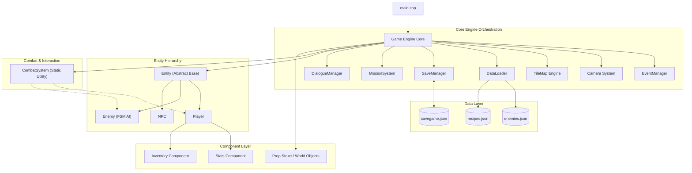

# MythForge: Modular 2D Action-Survival RPG Engine

MythForge is a modular 2D action-survival RPG game engine engineered in **C++17** using **SFML (Simple and Fast Multimedia Library)** and **`nlohmann/json`**. The project implements object-oriented design patterns—including runtime polymorphism, component composition, state machines, decoupled event orchestration, and data-driven configuration—to deliver combat, survival progression, and interactive quest gameplay within a 2.5D top-down environment.

---

## Key Features

- **Polymorphic Combat System**: Real-time melee slashing, directional hit detection, damage scaling with weapon tiers, stagger reactions, and ranged spellcasting.
- **Dynamic Enemy AI**: Diverse enemy archetypes (`ORC`, `SKELETON`, `KNIGHT`, `ROGUE`, `WIZZARD`) featuring finite state machines (`IDLE`, `PATROL`, `CHASE`, `ATTACK`, `STAGGER`, `DEAD`), proximity detection, and path steering.
- **Comprehensive Survival Loop**: Component-managed player metrics for health, stamina, and hunger with natural decay, starvation penalties, and nourishment-based health regeneration.
- **Resource Gathering & Crafting**: Chopping trees for wood, crushing rocks for stone/metal, farming crops, smelting ores at furnace stations, and constructing shelters and farming plots.
- **Multi-Layer TileMap World & Dynamic Camera**: Layered rendering for ground, animated water tiles, and river walls paired with a smooth player-tracking camera bounded to world coordinates.
- **NPC Dialogue Engine**: Proximity-activated interactions with dialogue queue handling, typewriter text rendering, and conversational flow.
- **Mission & Quest Tracking**: Multi-stage mission tracking (enemy kill quotas, resource gathering, house construction) with real-time UI status updates and level transition rewards.
- **State Persistence**: Serializes and restores player position, inventory, stats, unlocked levels, and world prop mutations to and from JSON.

---

## Technical Highlights & Architecture

### Object-Oriented Design & Extensibility
- **Abstract Base Classes & Runtime Polymorphism**: [`Entity`](include/Entity.h) provides a pure virtual interface (`update(float dt) = 0`, virtual `draw()`), implemented polymorphically across [`Player`](include/Player.h), [`Enemy`](include/Enemy.h), and [`NPC`](include/NPC.h). Entities are stored and updated via polymorphic smart pointers (`std::shared_ptr<Enemy>`), allowing runtime polymorphism without memory leaks.
- **Component-Based Composition**: Rather than deep inheritance trees, character stats and inventory are modeled as discrete components in [`Components.h`](include/Components.h):
  - `Stats`: Encapsulates health, stamina, and hunger thresholds, handling survival updates and delta-time regeneration.
  - `Inventory`: Encapsulates item count maps and equipment tiers (armor and weapon upgrades).
- **Finite State Machines (FSM)**:
  - Game lifecycle transitions: `MENU` ➔ `LEVEL_SELECT` ➔ `PLAYING` ➔ `DIALOGUE` ➔ `GAMEOVER` / `VICTORY`.
  - Player animation & action states: `IDLE`, `WALKING`, `ATTACKING`, `EATING`, `DRINKING`, `HARVESTING`, `CRUSHING`.
  - Enemy behavioral states: `IDLE`, `PATROL`, `CHASE`, `ATTACK`, `STAGGER`, `DEAD`.
- **Data-Driven Architecture**: Enemy properties (health, movement speed, detection radius, attack damage) and crafting recipes are parsed at startup via [`DataLoader`](include/DataLoader.h) using [`json.hpp`](include/json.hpp), allowing game tuning without recompilation.
- **Decoupled Event Handling**: An event bus (`EventManager`) enables decoupled communication across systems (e.g., harvesting events trigger mission objectives without direct inter-system coupling).

---

## Architecture Diagram



---

## Module Responsibilities

| Class / Component | Responsibilities | Verified Source |
| :--- | :--- | :--- |
| [`Entity`](include/Entity.h) | Abstract base class defining common sprite, texture, velocity, health, and transform coordinates; declares pure virtual `update(float dt)`. | [`include/Entity.h`](include/Entity.h) |
| [`Player`](include/Player.h) | Controls player input handling, 4-directional sprite animation sets, equipment attack levels, action triggers, and composite `Stats` and `Inventory`. | [`include/Player.h`](include/Player.h), [`src/Player.cpp`](src/Player.cpp) |
| [`Enemy`](include/Enemy.h) | Implements polymorphic enemy types (`ORC`, `SKELETON`, etc.) with AI state logic, patrol bounds, target tracking, attack intervals, and death timers. | [`include/Enemy.h`](include/Enemy.h), [`src/Enemy.cpp`](src/Enemy.cpp) |
| [`NPC`](include/NPC.h) | Passive world entity storing unique character IDs, names, and cyclical dialogue queues for player interaction. | [`include/NPC.h`](include/NPC.h), [`src/NPC.cpp`](src/NPC.cpp) |
| [`Game`](include/Game.h) | Central engine loop orchestrator: manages SFML window rendering, level loading, collision passes, UI overlay drawing, and state switching. | [`include/Game.h`](include/Game.h), [`src/Game.cpp`](src/Game.cpp) |
| [`CombatSystem`](include/CombatSystem.h) | Pure utility abstraction executing attack interactions, damage calculations, and player-to-enemy hit evaluation. | [`include/CombatSystem.h`](include/CombatSystem.h) |
| [`Components`](include/Components.h) | Lightweight data containers and logic modules (`Stats`, `Inventory`, `Prop`) modeling hunger/stamina decay and item ownership. | [`include/Components.h`](include/Components.h) |
| [`DataLoader`](include/DataLoader.h) | Static JSON parser converting external schema configurations into engine data structures (`EnemyData`, `RecipeData`). | [`include/DataLoader.h`](include/DataLoader.h), [`src/DataLoader.cpp`](src/DataLoader.cpp) |
| [`MissionSystem`](include/MissionSystem.h) | Objective and quest tracking engine displaying HUD mission goals, validating completion requirements, and rewarding progress. | [`include/MissionSystem.h`](include/MissionSystem.h), [`src/MissionSystem.cpp`](src/MissionSystem.cpp) |
| [`DialogueManager`](include/DialogueManager.h) | Text box renderer managing sentence queues, typewriter text pacing, and active conversational UI state. | [`include/DialogueManager.h`](include/DialogueManager.h), [`src/DialogueManager.cpp`](src/DialogueManager.cpp) |
| [`SaveManager`](include/SaveManager.h) | Serializes active session data (level index, player coordinates, inventory counts, world props) to JSON files. | [`include/SaveManager.h`](include/SaveManager.h), [`src/SaveManager.cpp`](src/SaveManager.cpp) |

---

## Technology Stack & Dependencies

- **Programming Language**: C++17
- **Multimedia & Rendering**: SFML 2.x (`sfml-graphics`, `sfml-window`, `sfml-system`, `sfml-audio`)
- **JSON Serialization**: `nlohmann/json` (v3.x single-header)
- **Compiler**: MinGW-w64 (`g++` supporting C++17)
- **Audio Backend**: OpenAL (`openal32.dll`)
- **Target Platform**: Windows (64-bit native executable)

---

## Repository Structure

```text
.
├── include/                   # Engine header interfaces
│   ├── AnimationManager.h     # Sprite frame animation logic
│   ├── Camera.h               # View tracking and boundaries
│   ├── CombatSystem.h         # Combat evaluation utilities
│   ├── Components.h           # Component models (Stats, Inventory, Prop)
│   ├── DataLoader.h           # JSON parsing utilities
│   ├── DialogueManager.h      # NPC dialogue rendering & queue
│   ├── Enemy.h                # Polymorphic enemy actor class
│   ├── Entity.h               # Abstract base class
│   ├── EventManager.h         # Decoupled observer event bus
│   ├── Game.h                 # Core engine coordinator
│   ├── MissionSystem.h        # Quest and mission manager
│   ├── NPC.h                  # Non-player character entity
│   ├── Player.h               # Player character implementation
│   ├── SaveManager.h          # JSON state serializer
│   ├── TileMap.h              # Multi-layer grid map engine
│   └── json.hpp               # nlohmann::json single-header library
├── src/                       # Source implementations
│   ├── Camera.cpp
│   ├── DataLoader.cpp
│   ├── DialogueManager.cpp
│   ├── Enemy.cpp
│   ├── Entity.cpp
│   ├── Game.cpp               # Core game loop & gameplay logic
│   ├── MissionSystem.cpp
│   ├── NPC.cpp
│   ├── Player.cpp
│   ├── SaveManager.cpp
│   ├── TileMap.cpp
│   └── main.cpp               # Application entry point
├── assets/                    # Textures, spritesheets, tilesets, and fonts
├── enemies.json               # Configurable enemy archetypes & stats
├── recipes.json               # Crafting recipe balance definitions
├── savegame.json              # Saved player profile & world state
├── build.bat                  # Automated compilation & launch script
├── HOW_TO_RUN.md              # Detailed terminal execution guide
└── Makefile                   # Optional make configuration
```

---

## Setup & Build Instructions

### Prerequisites
1. **Windows 10/11 (64-bit)**
2. **MinGW-w64 (`g++`)** installed and configured on your system `PATH` (supporting C++17).
3. **SFML 2.x** installed (default configuration expects headers and libraries at `C:/SFML/include` and `C:/SFML/lib`, or adjusted to your local SFML installation).

### Quick Build & Launch
For automated compilation and immediate execution via Command Prompt (`cmd`):

```cmd
build.bat
```

*The batch script kills previous running instances, compiles all source units, links required SFML libraries, and launches `game.exe`.*

### Manual Compilation
To compile manually via MinGW:

```cmd
g++ -std=c++17 src/*.cpp -Iinclude -IC:/SFML/include -LC:/SFML/lib -lsfml-graphics -lsfml-window -lsfml-system -lsfml-audio -o game.exe
game.exe
```

For detailed operational guidance and troubleshooting, refer to [`HOW_TO_RUN.md`](HOW_TO_RUN.md).

---

## Verified Controls

| Action | Key / Input | Context |
| :--- | :--- | :--- |
| **Movement** | `W` / `A` / `S` / `D` or Arrow Keys | Main Gameplay |
| **Attack** | `Spacebar` | Main Gameplay |
| **Interact / Talk** | `Spacebar` | Nearby NPC, Station, or Crop Plot |
| **Advance Dialogue**| `Spacebar` | Dialogue Window Active |
| **Eat Food** | `E` | Consumes 1 Food, Restores +20 Health |
| **Drink Water** | `Q` | Consumes 1 Water |
| **Craft Shelter** | `B` | Costs 50 Wood + 30 Stone |
| **Build Farm** | `V` | Costs 20 Wood + 10 Stone |
| **Plant Crops** | `F` | Plants seed at farm plot |
| **Upgrade Armor** | `C` | Costs 40 Stone (or via Anvil station) |
| **Upgrade Weapon**| `G` | Costs 60 Wood + 40 Stone |
| **Toggle Crafting**| `Tab` | Opens/closes crafting recipe overview |
| **Quick Save** | `F5` | Saves current level, player stats, & props |
| **Restart Game** | `R` | Game Over Screen |
| **Menu Select** | `Up` / `Down` + `Enter` | Main Menu & Level Select |

---

## Configuration & Save Schema

### 1. `enemies.json`
Controls entity archetypes, hitpoints, and movement attributes:
```json
{
    "id": "orc",
    "health": 50,
    "speed": 60,
    "damage": 10,
    "detectionRadius": 300,
    "behavior": "chase"
}
```

### 2. `recipes.json`
Defines item requirements and prerequisites for building:
```json
{
    "id": "farm",
    "name": "Farming Plot",
    "requirements": {
        "wood": 20,
        "stone": 10
    },
    "dependency": "house"
}
```

### 3. `savegame.json`
Serializes progression state, including player coordinates, survival attributes, resource counts, equipment levels, and dynamically placed world structures.

---

## Engineering Challenges & Implementation Solutions

1. **Decoupled Architecture vs. Game Loop Complexity**
   - *Challenge*: Early stages risked coupling game logic, audio, mission updates, and rendering into monolithic updates.
   - *Solution*: Segregated concerns by establishing an abstract [`Entity`](include/Entity.h) contract, wrapping stats into dedicated components, and introducing an `EventManager` to notify systems (e.g., harvesting triggering quest updates) without tight class couplings.

2. **2.5D Depth Sorting & Rendering Order**
   - *Challenge*: Top-down games require dynamic depth perception—entities must render behind roofs/tree tops when passing above, and in front when walking below.
   - *Solution*: Structured world props into separate `groundProps` and `overheadProps` vectors, performing collision calculations on foot-level hitboxes while layering overhead geometry after entity draw passes.

3. **Polymorphic Enemy AI State Management**
   - *Challenge*: Coordinating unique enemy movement patterns (kiting vs. aggressive chasing) without duplicating boilerplate.
   - *Solution*: Implemented an enum-driven Finite State Machine within [`Enemy.cpp`](src/Enemy.cpp), parameterizing speed, damage, and detection radii via external JSON while sharing core animation and collision routines.

4. **Robust Persistence of Dynamic World Objects**
   - *Challenge*: Saving modified world state (e.g., cut trees, built farms, deployed houses) without ballooning save files.
   - *Solution*: Developed a structured JSON serialization schema in [`SaveManager.cpp`](src/SaveManager.cpp) that iterates over active world props, persisting only mutated entities alongside core player metrics.

---

## Roadmap & Future Enhancements

The following features represent planned architectural and gameplay expansions:
- [ ] **Spatial Partitioning (QuadTree)**: Replace brute-force collision sweeps with a 2D QuadTree to optimize broad-phase collision detection for 500+ simultaneous entities.
- [ ] **Cross-Platform CMake Build System**: Transition from raw batch scripts to a portable `CMakeLists.txt` build pipeline supporting Linux and macOS.
- [ ] **A* Pathfinding**: Upgrade basic line-of-sight enemy steering to dynamic A* grid navigation navigating around complex player-built obstacles.
- [ ] **Particle System Pooling**: Implement object pooling for projectile and healing particle effects to eliminate runtime heap allocations during combat.

---

## Skills & Engineering Competencies

- **Modern C++ (C++17)**: Smart pointers (`std::shared_ptr`, `std::unique_ptr`), structured bindings, RAII, and standard containers (`std::vector`, `std::map`, `std::queue`).
- **Object-Oriented Design**: Pure virtual interfaces, inheritance hierarchies, composition over inheritance, and encapsulation.
- **Game Engine Foundations**: Delta-time frame loops, sprite-sheet animation parsing, multi-layer tile rendering, 2D viewport cameras, and collision resolution.
- **Serialization & Tooling**: JSON data binding, batch automation scripts, and dependency linking with external C++ libraries.

---

## License & Attribution

- **Source Code**: Developed as an educational modular game engine demonstrating C++ and OOP design patterns.
- **Asset Attribution**: Art assets sourced from open-source game development packages (including *Pixel Crawler* by itch.io creators). Assets remain under their respective licenses.
# MythForge-Modular_CPP_RPG-Engine

